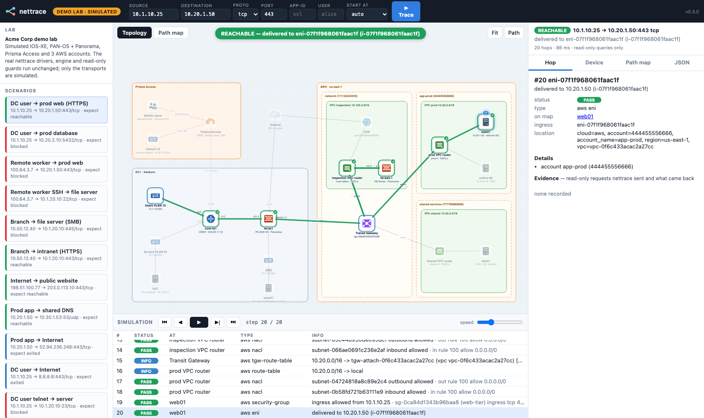
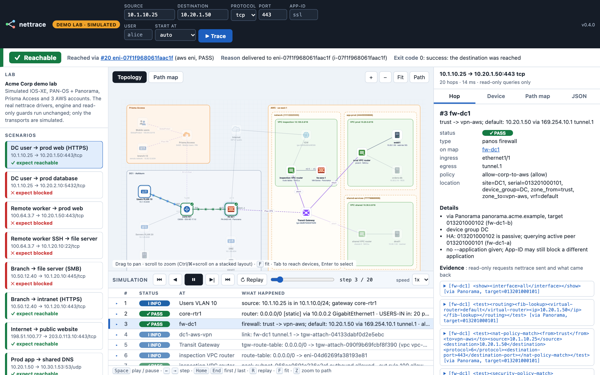
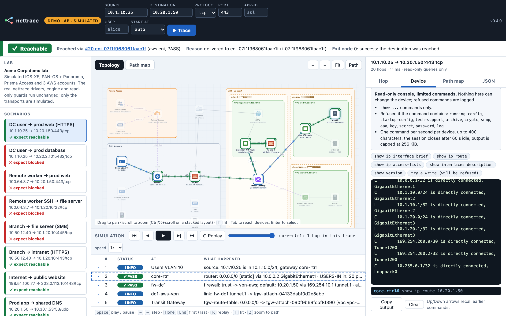

# nettrace

Read-only, hop-by-hop path tracer for a mixed Cisco IOS-XE / PAN-OS / Prisma Access / AWS network.
Give it a source, destination and port; it asks every component on the path (live) how it would
handle that flow and prints the result in the terminal.

```
nettrace trace run --source 10.1.1.10 --destination 10.20.1.50 --port 443
```

```
 #  Status  Where                       In / Out               Lookup / Decision                                   Policy / NAT
 1  INFO    10.1.1.10 engine source                            10.1.1.10 is in 10.1.0.0/16; gateway core-rtr1
 2  PASS    core-rtr1 cisco router      Gi2 / Gi1              10.20.0.0/16 [ospf 1] via 10.0.0.2 Gi1               ACL_IN in: 10 permit tcp any 10.20.0.0 ...
 3  PASS    fw-dc1 panos firewall       ethernet1/1 / tunnel.1 trust -> vpn; default: 10.20.1.50 via 169.254.10.1  allow-aws (allow)
 4  INFO    dc1-vpn engine link                                fw-dc1 tunnel.1 -> tgw-attach-0123...
 5  INFO    tgw-rtb-... aws tgw-route-table                    10.20.0.0/16 -> tgw-attach-0abc... (vpc vpc-...) [propagated]
 6  INFO    rtb-... aws route-table                            10.20.0.0/16 -> local
 7  PASS    acl-... aws nacl                                   subnet-... outbound allowed                          out rule 100 allow 0.0.0.0/0
 8  PASS    acl-... aws nacl                                   subnet-... inbound allowed                           in rule 100 allow 0.0.0.0/0
 9  PASS    sg-... aws security-group   eni-... / -            ingress allowed from 10.1.1.10                       sg-... ingress tcp 443-443 10.0.0.0/8
10  PASS    eni-... aws eni                                    delivered to 10.20.1.50 (i-0abc...)
 REACHABLE   delivered to eni-... (i-0abc...)
```

> **Status:** v0.4.0. Verified only in simulation, not yet run against live devices. PAN-OS firewalls
> are queried through Panorama (or directly). Traces can be drawn as path maps, or explored in a
> local web UI with a built-in demo lab (see [Try it](#try-it-demo-lab-and-web-ui)). For project
> intent, internals, gaps and roadmap, see [AGENTS.md](AGENTS.md) and [docs/](docs/).

## Try it: demo lab and web UI

```bash
nettrace demo serve            # serves http://127.0.0.1:8765 against the simulated Acme Corp lab
```

It opens your browser at a one-time login URL (`http://127.0.0.1:8765/?c=...`); nothing to paste. The link works
once and expires after 60 s. Add `--no-open` to only print it (open it within 60 s). If it expired or was used, run
the command again. (`--open` is still accepted and does nothing.)

A blocked trace: the verdict bar says where it stopped and why, the topology marks the blocking device, and the
hop list and inspector show the evidence behind each verdict.



A passing trace plays as a packet flow along the path (Space plays or pauses, arrows step, `R` replays):



**The demo lab** is a simulated hybrid network built to resemble a mixed Cisco / Palo Alto / Prisma
Access / AWS environment:
- **DC1** — an IOS-XE core router (interface ACLs) and a PA-3420 HA pair managed by Panorama. The
  inventory lists the passive member, so you can watch nettrace follow HA to the active member.
- **DC1 edge** — a DMZ web server published by destination NAT, and source NAT for internet access.
- **Prisma Access** — mobile users and a branch remote network, joined to DC1 by a service connection.
- **Three AWS accounts** on one Transit Gateway:
  - an inspection VPC with a VM-Series firewall;
  - prod and shared-services VPCs reached through TGW route tables that force traffic through
    the inspection VPC;
  - security groups that reference each other, and a NACL on the database subnet.

Only the transports are simulated (SSH, XML API, SCM HTTP, AWS API). The real drivers, the engine
and the read-only guards all run unchanged. The simulated devices compute their answers (routing,
ACLs, policy and NAT matching, AWS describe filters) from one lab model, `src/nettrace/demo/lab.py`,
so any source and destination you type gets a real answer, not just the presets.

**The web UI:**
- **Topology canvas.** Device icons, interface labels, tunnels and TGW attachments, grouped into
  sites, accounts and VPCs.
- **Simulation panel.** Run, play, pause, step and rewind; a stream of packets flows hop by hop across the
  topology (pause freezes it; stepping while paused keeps it frozen), as in Packet Tracer's simulation mode. The event list shows every hop with its status,
  and off-path devices are dimmed.
- **Inspector:**
  - **Hop** — the decision, policy, NAT, location, and every read-only request and answer;
  - **Device** — device facts, the hops at that device in this trace, and a console;
  - **Path map** — the NetBrain-style map from `viz`;
  - **JSON** — the raw trace.
- **Device console.** Runs read-only commands on the device (simulated in the demo, real in live
  mode). The "try a write ✋" chip shows the read-only guard refusing `configure terminal` or a PAN-OS
  `<request>`.
- **Scenarios and history.** 12 preset scenarios with an expected outcome each (see
  `nettrace demo scenarios`), plus a history of recent traces.
- **Deep links.** `#preset=branch-smb&step=last&node=core-rtr1` opens a scenario at a given step
  with a node selected; `#trace=<id>` reopens a trace from history. These work after
  you are logged in; an old `#token=` in a link is ignored.

The Device tab has a read-only console for the simulated device. It lists the allowed commands, refuses the rest,
and logs refusals:



The same lab also works from the CLI. Add `--demo` to any command:

```bash
nettrace demo scenarios
nettrace --demo trace run -s 10.1.10.25 -d 10.20.1.50 -p 443 -v
nettrace --demo trace run -s 100.64.3.7 -d 10.1.20.10 -p 22 --application ssh
nettrace --demo panorama list-devices
nettrace --demo cisco check-acl --device core-rtr1 --acl SERVERS-OUT -s 10.50.12.40 -d 10.1.20.10 -p 445
```

**Against your real network:** `nettrace serve` opens the same UI against your inventory. The
topology is generated from the inventory (sites, Prisma Access, AWS accounts, links), and traces
and console commands query the real devices read-only.

How the server is locked down:
- it binds to 127.0.0.1 only;
- every API call needs the per-run session. The printed URL carries a separate one-time login code (single use,
  60 s). It is visible in the browser launcher's argument list, which is why it is single-use and short-lived. The
  server swaps it for an `HttpOnly; SameSite=Strict` session cookie and redirects to a clean URL. API calls
  must also send an `X-Nettrace-Client: 1` header, and the Host/Origin checks still apply. The browser is started
  without `NETTRACE_*` and `AWS_*` variables (`open` on macOS, `xdg-open` on Linux);
- the console allows one session per device, at most one command per second, closes the session after
  60 s idle, and caps output at 256 KiB;
- after an SSH authentication failure nettrace refuses new logins to that device for 5 minutes, so a
  wrong shared password can't lock the account;
- it rejects requests whose Host or Origin header isn't the local server;
- it only accepts JSON request bodies, up to 64 KiB;
- the page loads nothing from the network (strict CSP).

## What it reuses

| Need | Library / API | Notes |
|---|---|---|
| Cisco SSH | [Netmiko](https://github.com/ktbyers/netmiko) | `show` commands only |
| Cisco parsing | [ntc-templates](https://github.com/networktocode/ntc-templates) (TextFSM) | `show ip interface`, `show ip interface brief`, `show ip arp`, `show ip access-lists` |
| PAN-OS | PAN-OS XML API | the firewall evaluates the flow itself: `test routing fib-lookup`, `test nat-policy-match`, `test security-policy-match` |
| Panorama | PAN-OS XML API `target=<serial>` | proxies those firewall queries; supplies managed devices, HA state, device groups |
| Prisma Access | Strata Cloud Manager config API | GET security rules + objects, evaluated by nettrace |
| AWS | boto3 | `Describe*`, `Get*`, `SearchTransitGatewayRoutes` |
| Output | rich, JMESPath | `--output table|json|text`, `--query` like the AWS CLI |

Tools that were considered and not used as the base: **Batfish** (models saved configs rather than
querying live devices; no Prisma Access; PAN-OS Advanced Routing unsupported), **SuzieQ** (no AWS;
path view doesn't evaluate firewall policy), **AWS Reachability Analyzer** (creates resources and is
billed per analysis, so it isn't read-only; AWS-only).

## Install

```bash
cd tracer
python3 -m venv .venv
.venv/bin/pip install -e .
.venv/bin/nettrace --help        # or activate the venv and run `nettrace`
```

For a reproducible install, use the hashed lockfile (every dependency pinned, including transitive ones):

```bash
.venv/bin/pip install --require-hashes --no-deps -r requirements.lock
.venv/bin/pip install --no-deps -e .
```

To refresh the lockfile and check it for known vulnerabilities (use a separate venv for the tools):

```bash
pip-compile --generate-hashes --strip-extras -o requirements.lock pyproject.toml   # slow: hashes every wheel
pip-audit -r requirements.lock --require-hashes --disable-pip
```

## Configure

### 1. Inventory

Copy `inventory.example.yaml` to `inventory.yaml` (git-ignored) and edit it. nettrace looks for, in order:
`--inventory`, `$NETTRACE_INVENTORY`, `./inventory.yaml`, `~/.nettrace/inventory.yaml`.

| Section | Purpose |
|---|---|
| `panorama` | Panorama host (plus optional HA `peer_host`). PAN-OS devices with a `serial` are queried through it. |
| `devices` | Cisco (`cisco_iosxe`) and PAN-OS (`panos`) devices. A PAN-OS device needs a `serial` (queried through Panorama) or a `host` (`via: direct`). PAN-OS VMs in AWS get an `aws:` block (`instance_id`, and `gwlb_endpoints` + `gwlb_zone` if they sit behind a Gateway Load Balancer). |
| `networks` | On-prem source prefixes and their first-hop device. |
| `aws.accounts` | Every account to search, with the role to assume and regions. |
| `prisma_access` | Mobile-user IP pools, remote-network prefixes, service connections and the prefixes reachable through each. |
| `links` | How the domains connect: device interface / next hop <-> TGW attachment, VGW, Prisma Access service connection, or `external: "Internet (ISP-A)"` (the trace ends there as EXITED). |

Next hops are resolved to devices from `devices[].addresses` and from a cache that
`nettrace inventory discover` fills by reading interface IPs from every device.

With Panorama, generate the firewall entries instead of typing them:

```bash
nettrace panorama list-devices                 # serial, HA state, device group, already in inventory?
nettrace panorama generate-inventory >> devices-from-panorama.yaml   # review, then merge into inventory.yaml
nettrace inventory discover                    # interface IPs, read through Panorama
```

Each HA pair needs one entry. If the listed serial is the passive member, nettrace queries the active
peer (`follow_ha_active: true`, the default) and says so in the hop details.

### 2. Credentials (environment variables only)

| Variable | Used for |
|---|---|
| `NETTRACE_CISCO_USERNAME`, `NETTRACE_CISCO_PASSWORD`, `NETTRACE_CISCO_SECRET` (optional) | Cisco SSH. Override per device with `username_env` / `password_env` / `secret_env`. |
| `NETTRACE_PANORAMA_API_KEY` | Panorama XML API key (`X-PAN-KEY` header). Used for every firewall queried through Panorama. Override with `panorama.api_key_env`. |
| `NETTRACE_PANOS_API_KEY` | PAN-OS XML API key for firewalls queried directly (`via: direct`). Override per device with `api_key_env`. |
| `NETTRACE_SCM_CLIENT_ID`, `NETTRACE_SCM_CLIENT_SECRET`, `NETTRACE_SCM_TSG_ID` | Strata Cloud Manager service account. |
| standard AWS variables (`AWS_PROFILE`, `AWS_ACCESS_KEY_ID`, SSO, ...) | Base credentials used to call `sts:AssumeRole` into each `aws.accounts[].role_arn`. |
| `NETTRACE_INVENTORY`, `NETTRACE_OUTPUT`, `NETTRACE_CACHE_DIR` | Defaults for `--inventory`, `--output`, discovery cache location. |

Check what's set (values are never printed) and test connectivity:

```bash
nettrace configure check
nettrace configure check --test-connections
```

### 3. Least-privilege credentials

nettrace refuses to send anything that isn't a read (see `src/nettrace/readonly.py`), but the
credentials should be read-only too:

- **AWS**: create `NetTraceReadOnly` in each account with `iam/nettrace-readonly-policy.json`
  (or the AWS-managed `ReadOnlyAccess`), trusted by the principal you run nettrace as (name the
  principal, not `:root`). nettrace assumes it for 900 s (re-assuming once when the session expires),
  passes the same policy file as an inline session policy, and names the session
  `nettrace-<user>-<host>` so CloudTrail shows who ran it. Set `aws.base_account_id`; a role in any
  other account then needs `external_id_env`. Prefer SSO or short-lived profiles over IAM-user keys.
- **Setting the variables**: don't type `export VAR=secret` (shell history). Use a secret manager
  wrapper (`op run -- nettrace ...`), the macOS Keychain, or `read -rs VAR && export VAR`.
- **Panorama**: an admin with the built-in *Panorama administrator (read-only)* role, or a custom
  Panorama Admin Role Profile with XML API *Operational Requests* and *Configuration*. Its access
  domain must include the device groups and managed devices you trace through. Check in your
  environment that requests proxied with `target=` may run `test ...-policy-match` on the firewalls.
- **PAN-OS (direct)**: an admin with the built-in *Superuser (read-only)* role, or a custom Admin Role
  Profile with XML API *Operational Requests* (for `show`/`test`) and *Configuration* (used only for
  `get`/`show`, to read rule actions, NAT translations and address objects). Check in your
  environment that the role permits the `test ...-policy-match` commands.
- **Cisco**: a user restricted to `show` commands (TACACS+ command authorization or a privilege level
  that includes `show ip route`, `show ip cef`, `show ip interface`, `show ip arp`, `show ip access-lists`).
- **Strata Cloud Manager**: a service account with a view-only role.

## Usage

The structure is `nettrace <service> <command> [options]`, like `aws <service> <command>`. Global
options (`--output`, `--query`, `--inventory`, `--no-color`, `--debug`) can go anywhere on the line.

```bash
# full trace
nettrace trace run -s 10.1.1.10 -d 10.20.1.50 -p 443
nettrace trace run -s 10.1.1.10 -d 10.20.1.50 -p 443 --verbose          # hop details + every request/answer
nettrace trace run -s 100.64.3.7 -d 10.20.1.50 -p 22 --application ssh --user alice
nettrace trace run -s 10.1.1.10 -d 8.8.8.8 --protocol icmp
nettrace trace run -s 10.1.1.10 -d 10.20.1.50 -p 443 --start-at core-rtr1

# scripting
nettrace trace run -s 10.1.1.10 -d 10.20.1.50 -p 443 --output json
nettrace trace run -s 10.1.1.10 -d 10.20.1.50 -p 443 --output json \
    --query 'Hops[?status==`BLOCK`].{node: node, why: summary, policy: policy}'
nettrace trace run -s 10.1.1.10 -d 10.20.1.50 -p 443 --output text | grep ^HOP

# single-component lookups
nettrace cisco show-route --device core-rtr1 -d 10.20.1.50
nettrace cisco check-acl --device core-rtr1 --acl ACL_IN -s 10.1.1.10 -d 10.20.1.50 -p 443
nettrace panos lookup-route --device fw-dc1 -d 10.20.1.50
nettrace panos test-security-policy --device fw-dc1 -s 10.1.1.10 -d 10.20.1.50 -p 443
nettrace panos test-nat-policy --device fw-dc1 -s 10.1.1.10 -d 203.0.113.10 -p 443
nettrace panorama list-devices --connected-only
nettrace panorama show-device --device fw-dc1          # queried serial (after HA), device-group chain
nettrace panorama generate-inventory
nettrace prisma list-security-rules --folder "Mobile Users"
nettrace prisma test-security-policy --folder "Mobile Users" -s 100.64.3.7 -d 10.20.1.50 -p 443
nettrace aws find-ip --ip 10.20.1.50
nettrace aws describe-route --account app-prod --region us-east-1 --subnet-id subnet-0abc -d 10.1.1.10
nettrace aws search-tgw-routes --account network --region us-east-1 --route-table-id tgw-rtb-0abc -d 10.1.1.10

# inventory
nettrace inventory list
nettrace inventory validate
nettrace inventory resolve --ip 10.20.1.50 --aws
nettrace inventory discover

# path maps
nettrace trace run -s 10.1.1.10 -d 10.20.1.50 -p 443 --map trace.html --open
nettrace viz render --input trace.json --out-file trace.svg
```

Exit codes for `trace run`: `0` reachable or left the known network (internet / unmanaged next hop),
`3` blocked, `4` incomplete (something couldn't be evaluated, including a reachable or exited path
with an UNKNOWN hop), `1` error.

Cancelling: Ctrl-C during `trace run` stops the trace at the next safe point (before the next device or
API request, never mid-request), prints the hops found so far, and exits `4` (INCOMPLETE, reason
"cancelled by user") with no traceback. In the web UI, a running trace shows a **Cancel** button (next to
Trace and in the busy overlay; **Esc** in the overlay also cancels). A device or API request already sent
finishes first, bounded by its own timeout, so the stop is not instant. The result is shown as
Unverified (INCOMPLETE) with the hops found so far, never as reachable.

## Path maps

A NetBrain-style map of a trace: device icons left to right in path order, grouped into boxes for
on-prem sites, Prisma Access, AWS account + region, and VPC. Security groups and NACLs are drawn
as ✓/✕ badges on the link they guard, the way an interface ACL appears on a NetBrain map. Where
the flow stops, the line turns faded and dashed up to a "not reached" destination.

```bash
nettrace trace run -s 10.1.1.10 -d 10.20.1.50 -p 443 --open                 # trace, then open the map
nettrace trace run -s 10.1.1.10 -d 10.20.1.50 -p 443 --map ticket-1234.html
nettrace trace run -s 10.1.1.10 -d 10.20.1.50 -p 443 --map ticket-1234.svg  # static image

# from saved traces
nettrace trace run ... --output json > a.json
nettrace viz render --input a.json --out-file a.html --open
nettrace viz render --input a.json --input b.json --out-file both.html     # one page, trace picker
nettrace trace run ... --output json | nettrace viz render --out-file a.svg
```

Maps are written owner-only (mode 0600) and leave out hop evidence (raw device output) unless you
pass `--with-evidence`; such an HTML map shows a "contains device output: do not share" banner.
`--output json > file` is created by your shell, so `chmod 600` it or set `umask 077`.

- **`.html`** is one self-contained file that works offline (no CDN, fonts or external scripts):
  - drag to pan, scroll to zoom;
  - click any device, SG/NACL badge or link to see that hop's decision, policy, NAT and location,
    plus the raw read-only requests and answers;
  - the page opens on the first BLOCK or UNKNOWN hop;
  - there are buttons to download the SVG or the trace JSON;
  - `#trace=2&hop=10` in the URL opens a specific trace and hop.
- **`.svg`** is a static image for tickets and wikis. It includes the outcome, flow and reason as a
  header, and hovering any element shows its details.

Set `site:` on devices in the inventory to split on-prem into named boxes such as `DC1` or
`Branch-12`. The default is `On-prem`.

## How each component is evaluated

**Cisco IOS-XE.** Ingress interface comes from the address the previous hop sent to (or the route back to
the source on the first hop). nettrace reads the VRF and ACLs with `show ip interface`, finds the next hop with
`show ip cef [vrf X] <dst>` plus `show ip route` for the protocol, and evaluates the inbound and outbound ACLs
from `show ip access-lists`. On connected subnets it also checks ARP. If an ACL entry can't be evaluated
(object-groups, unparsed lines), it is listed instead of guessed. ECMP follows the first path and warns.

**PAN-OS (on-prem and EC2).** The firewall answers for itself: `show interface all` for zones, then
`test routing fib-lookup` (or `test advanced-routing fib-lookup` with `routing_engine: advanced`), then
`test nat-policy-match`. If there is a destination NAT, nettrace redoes the route lookup on the translated
address to get the post-NAT zone, the same way PAN-OS picks the zone for security policy. Last comes
`test security-policy-match`. Without `--application`, a pass means "allowed at layer 4"; App-ID could
still block other applications.

Through Panorama, these same requests go to Panorama with `target=<serial>`, and Panorama forwards
them to the firewall. Panorama is never asked to run a policy test itself. Where it gets details:
- **Managed firewalls and HA state:** `show devices all`.
- **Device group membership:** `show devicegroups`.
- **Device-group parents:** `show dg-hierarchy`.

To show NAT translations and rule actions, nettrace looks the matched rule up in three places, in
order: the firewall's local config, then the Panorama-pushed config on the firewall, then
Panorama's device-group chain (device group, its parents, then shared).

**Prisma Access.** nettrace reads the folder's security rules (pre, then post) and their address and service
objects from Strata Cloud Manager, then does a first-match evaluation. Criteria it can't evaluate are reported:
App-ID without `--application`, user groups, URL categories, HIP, FQDN and dynamic objects. Prisma Access
routing (to a service connection, remote network, mobile users or the internet) comes from the inventory,
because the config API doesn't expose routing state.

**AWS.** Source/destination ENIs are found across all inventory accounts and regions. Each step is evaluated
in order:
- security groups (stateful, with prefix lists and SG references);
- NACLs at every subnet boundary, including the TGW-attachment-subnet rules from the AWS docs, plus a
  warning-level return-path check (ephemeral port 49152 or `--source-port`);
- subnet route tables (longest prefix match, prefix lists, blackholes);
- Transit Gateway route tables, using the attachment's association and `SearchTransitGatewayRoutes`,
  with AZ affinity and inter-region peering;
- GWLB endpoints, which hand the flow to the inventory VM-Series in inline mode and then resume from
  the endpoint subnet;
- routes to appliance ENIs, checking the source/dest check flag and the ENI's SGs, then the PAN-OS
  hop, then back into AWS from the firewall's egress ENI;
- NAT gateways (the source IP is rewritten), IGWs, VPC peering and VGWs.

## Limitations

- Paths are followed one at a time; with ECMP only the first path is traced (and flagged).
- The TGW/VPC side is evaluated from configuration and route tables (like Reachability Analyzer). It
  doesn't use flow logs.
- Cisco: no ZBFW, PBR, or NAT evaluation. Object-group ACL entries are reported as uncertain.
- PAN-OS: the official PAN Ansible collection notes the XML API may not support
  `test advanced-routing fib-lookup` on some versions. In that case the hop shows an error.
  App-ID, URL filtering and threat profiles aren't simulated.
- Prisma Access: config-based evaluation, not a live policy test. The rule order returned by SCM is
  taken as evaluation order.
- IPv4 is the focus. IPv6 routes and SG/NACL entries are matched, but Cisco/PAN IPv6 lookups aren't.
- Not supported yet: AWS Cloud WAN, Local/Carrier gateways, and Direct Connect gateway internals
  (DX attachments are followed through `links`).
